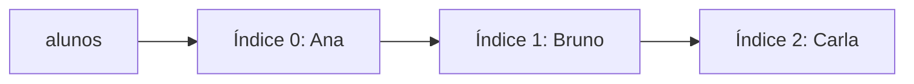
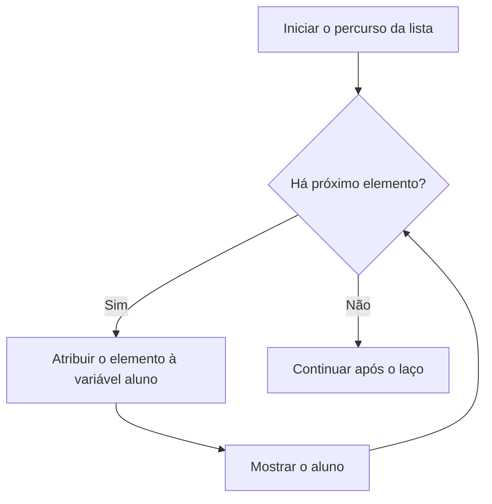

# Tópico 05 — Listas em Python

## Objetivos da aula

Ao final desta aula, o aluno deverá ser capaz de:

- criar listas para armazenar vários valores;
- acessar e alterar elementos por seus índices;
- adicionar, remover e procurar elementos;
- percorrer listas com `for`;
- combinar listas, entradas, condicionais e repetições;
- produzir relatórios simples a partir dos dados armazenados.

**Pré-requisito:** [Tópico 04 — Estruturas de Repetição com `for`](07%20-%20Estruturas%20de%20Repetição%20com%20For.md).

---

# 1. Por que usar listas?

Na aula anterior, calculamos uma média acumulando notas. Ao terminar cada repetição, a variável `nota` recebia um novo valor. O total era preservado, mas não guardávamos cada nota para consultar depois.

Uma **lista** permite armazenar vários elementos em uma única variável, mantendo a ordem em que foram organizados.

```python
notas = [8.0, 6.5, 9.0, 7.5]
print(notas)
```

Saída:

```text
[8.0, 6.5, 9.0, 7.5]
```

Agora podemos consultar, alterar e percorrer as notas quantas vezes forem necessárias durante a execução.

**Atenção:** a lista fica na memória do programa. Guardar os dados para outra execução exige outros recursos, que estudaremos depois.

---

# 2. Criando listas

Utilizamos colchetes `[]` e separamos os elementos por vírgulas:

```python
alunos = ["Ana", "Bruno", "Carla"]
idades = [16, 18, 17]
precos = [12.50, 8.00, 20.90]
mochila = []
```

Uma lista pode começar vazia e receber elementos ao longo do programa.

Python também permite misturar tipos, como em `["Ana", 17, True]`. Nesta aula, usaremos principalmente listas cujos elementos têm o mesmo tipo, para facilitar as operações.

Listas aceitam valores repetidos:

```python
pontuacoes = [10, 20, 10]
print(len(pontuacoes))  # 3
```

A função `len()` informa a quantidade de elementos, incluindo os repetidos.

---

# 3. Índices: a posição de cada elemento

Cada elemento possui uma posição, chamada **índice**. A contagem começa em **zero**.

```python
alunos = ["Ana", "Bruno", "Carla"]

print(alunos[0])   # Ana
print(alunos[1])   # Bruno
print(alunos[2])   # Carla
print(alunos[-1])  # Carla
```



As setas mostram a ordem dos elementos, não uma estrutura de ponteiros na memória.

| Elemento | Índice positivo | Índice negativo |
| --- | --- | --- |
| `"Ana"` | `0` | `-3` |
| `"Bruno"` | `1` | `-2` |
| `"Carla"` | `2` | `-1` |

O índice `-1` acessa o último elemento. Para uma lista com três elementos, os índices positivos válidos são `0`, `1` e `2`. Acessar `alunos[3]` gera `IndexError`.

Uma lista vazia não possui primeiro nem último elemento. Verifique o tamanho antes de acessar:

```python
alunos = []

if len(alunos) > 0:
    print("Último aluno:", alunos[-1])
else:
    print("Nenhum aluno cadastrado.")
```

---

# 4. Alterando um elemento

Listas são **mutáveis**: podemos modificar seu conteúdo depois da criação.

```python
notas = [8.0, 6.5, 9.0]
notas[1] = 7.0

print(notas)  # [8.0, 7.0, 9.0]
```

A atribuição substitui o elemento do índice indicado. A quantidade de elementos permanece igual.

**Importante:** `notas[3] = 10` não adiciona um elemento a essa lista; o índice `3` ainda não existe. Para adicionar, utilizamos uma operação própria.

---

# 5. Adicionando elementos

## `append()`: adicionar ao final

```python
mochila = []
mochila.append("corda")
mochila.append("lanterna")
mochila.append("água")

print(mochila)  # ['corda', 'lanterna', 'água']
```

O ponto liga a lista à operação que será realizada. Chamamos essas operações de **métodos**.

## `insert()`: escolher uma posição

```python
alunos = ["Ana", "Carla"]
alunos.insert(1, "Bruno")

print(alunos)  # ['Ana', 'Bruno', 'Carla']
```

Nesse exemplo, `"Bruno"` entra no índice `1`, e `"Carla"` passa para o índice `2`.

**Não escreva `alunos = alunos.append("Diego")`.** O método altera a lista e retorna `None`. Utilize apenas `alunos.append("Diego")`.

---

# 6. Removendo elementos

| Operação | Como escolhe o elemento? | Resultado |
| --- | --- | --- |
| `lista.remove(valor)` | Pelo valor | Remove a primeira ocorrência desse valor |
| `lista.pop(indice)` | Pelo índice | Remove e retorna o elemento daquela posição |
| `lista.pop()` | Pela última posição | Remove e retorna o último elemento |

Exemplo com `remove()`:

```python
mochila = ["água", "corda", "água"]
mochila.remove("água")

print(mochila)  # ['corda', 'água']
```

Apenas a primeira ocorrência foi removida. Se o valor não existir, `remove()` gera `ValueError`. Podemos verificar antes com `in`:

```python
mochila = ["corda", "água"]
item = input("Qual item deseja remover? ")

if item in mochila:
    mochila.remove(item)
    print("Item removido.")
else:
    print("Item não encontrado.")
```

Exemplo com `pop()`:

```python
fila = ["Ana", "Bruno", "Carla"]
atendido = fila.pop(0)

print("Atendido:", atendido)  # Atendido: Ana
print("Fila:", fila)         # Fila: ['Bruno', 'Carla']
```

Após uma remoção, os índices dos elementos seguintes mudam. `pop()` em uma lista vazia ou com índice inexistente gera `IndexError`.

---

# 7. Procurando e contando valores

O operador `in` verifica se um valor está na lista. O método `count()` conta suas ocorrências.

```python
itens = ["água", "corda", "água"]

print("corda" in itens)       # True
print("lanterna" in itens)    # False
print(itens.count("água"))    # 2
```

A comparação de textos diferencia maiúsculas e minúsculas: `"Água"` e `"água"` são valores distintos.

---

# 8. Percorrendo uma lista com `for`

Na aula anterior, percorremos números de `range()` e caracteres de um texto. Agora, o `for` receberá cada elemento de uma lista:

```python
alunos = ["Ana", "Bruno", "Carla"]

for aluno in alunos:
    print("Aluno:", aluno)
```

Saída:

```text
Aluno: Ana
Aluno: Bruno
Aluno: Carla
```



Se a lista estiver vazia, o bloco não executa nenhuma vez.

Quando precisamos do índice, podemos combinar `range()` e `len()`:

```python
notas = [8.0, 6.5, 9.0]

for indice in range(len(notas)):
    print("Índice:", indice, "Nota:", notas[indice])
```

Prefira percorrer diretamente os elementos quando não precisar de suas posições.

**Cuidado:** adicionar ou remover elementos da mesma lista durante seu percurso pode fazer elementos serem pulados ou prolongar o laço. Nos exemplos desta aula, faremos essas alterações fora do percurso ou criaremos outra lista.

---

# 9. Lendo valores e guardando em uma lista

Vamos armazenar quatro notas, validar a faixa e consultar os dados depois:

```python
notas = []

for numero in range(1, 5):
    print("Nota número:", numero)
    nota = float(input("Digite uma nota de 0 a 10: "))

    while nota < 0 or nota > 10:
        nota = float(input("Nota inválida. Digite de 0 a 10: "))

    notas.append(nota)

total = 0
aprovadas = 0

for nota in notas:
    total += nota

    if nota >= 7:
        aprovadas += 1

media = total / len(notas)

print("Notas registradas:", notas)
print("Média:", media)
print("Notas a partir de 7:", aprovadas)
```

Para as entradas `8`, `6`, `10` e `4`, o resultado será:

```text
Notas registradas: [8.0, 6.0, 10.0, 4.0]
Média: 7.0
Notas a partir de 7: 2
```

A lista é criada **antes** do primeiro laço. Se `notas = []` estivesse dentro dele, os dados anteriores seriam descartados a cada repetição.

Considere entradas numéricas no formato correto, usando ponto nos decimais. A validação de faixa não trata textos como `dez`.

---

# 10. Soma, maior e menor valor

Python oferece funções para operações frequentes com listas numéricas:

```python
notas = [8.0, 6.0, 10.0, 4.0]

print("Quantidade:", len(notas))  # 4
print("Soma:", sum(notas))        # 28.0
print("Maior:", max(notas))       # 10.0
print("Menor:", min(notas))       # 4.0
```

Para uma lista vazia, `sum([])` retorna `0`, mas `max([])` e `min([])` geram `ValueError`. A média também precisa de proteção para evitar divisão por zero:

```python
notas = []

if len(notas) > 0:
    print("Média:", sum(notas) / len(notas))
    print("Maior nota:", max(notas))
    print("Menor nota:", min(notas))
else:
    print("Nenhuma nota registrada.")
```

---

# 11. Criando uma lista com os valores selecionados

Podemos percorrer uma lista e guardar em outra apenas os valores que atendem a uma condição:

```python
numeros = [5, -2, 0, 8, -1, 8]
positivos = []

for numero in numeros:
    if numero > 0:
        positivos.append(numero)

print("Originais:", numeros)   # [5, -2, 0, 8, -1, 8]
print("Positivos:", positivos)  # [5, 8, 8]
```

O zero não entra na nova lista, pois a condição é `numero > 0`. Os valores repetidos e sua ordem são preservados.

---

# 12. Fatiamento: selecionando um trecho

O fatiamento cria uma nova lista com parte dos elementos. Na forma `lista[inicio:fim]`, o início é incluído e o fim é excluído, como no limite de `range()`.

```python
itens = ["corda", "água", "mapa", "lanterna"]

print(itens[1:3])  # ['água', 'mapa']
print(itens[:2])   # ['corda', 'água']
print(itens[2:])   # ['mapa', 'lanterna']
```

Ao omitir o início, começamos no primeiro elemento. Ao omitir o fim, seguimos até o último.

---

# 13. Uma atribuição não copia a lista

Observe este exemplo:

```python
original = [10, 20, 30]
outra = original
outra[0] = 99

print(original)  # [99, 20, 30]
```

As duas variáveis se referem à mesma lista. Para criar uma cópia independente de uma lista de números ou textos, utilize `copy()`:

```python
original = [10, 20, 30]
copia = original.copy()
copia[0] = 99

print(original)  # [10, 20, 30]
print(copia)     # [99, 20, 30]
```

Essa é uma cópia superficial. Quando estudarmos listas dentro de listas, veremos os cuidados adicionais necessários.

---

# 14. Erros comuns

| Problema | O que conferir |
| --- | --- |
| O primeiro elemento não apareceu | O primeiro índice é `0` |
| O acesso gerou `IndexError` | O índice existe? A lista está vazia? |
| `remove()` gerou `ValueError` | O valor está na lista? Verifique com `in` |
| A variável virou `None` após adicionar | Use `lista.append(valor)` sem atribuir o retorno |
| Apenas o último dado foi guardado | Crie a lista antes do laço de leitura |
| A média gerou divisão por zero | Confira se `len(lista) > 0` |
| Alterar uma variável mudou outra lista | Uma atribuição simples compartilha a mesma lista |

Alterar a variável de percurso também não substitui o elemento da lista:

```python
numeros = [1, 2, 3]

for numero in numeros:
    numero = numero * 2

print(numeros)  # [1, 2, 3]
```

Para substituir os elementos por seus dobros, use seus índices:

```python
numeros = [1, 2, 3]

for indice in range(len(numeros)):
    numeros[indice] = numeros[indice] * 2

print(numeros)  # [2, 4, 6]
```

---

# Desafio rápido em sala

Sem executar, escreva a lista final, seu tamanho e o valor de `retirado`:

```python
itens = ["mapa", "corda", "água"]
itens.append("lanterna")
itens[1] = "bússola"
retirado = itens.pop(0)

print(itens)
print(len(itens))
print(retirado)
```

Depois, confira no terminal. Qual elemento passou a ocupar o índice `0` após a remoção?

---

# Exercícios

Crie um arquivo `.py` para cada exercício. Utilize listas e os conteúdos estudados até aqui, sem funções próprias ou tratamento de exceções. Considere entradas numéricas no formato correto.

## Exercício 01 — Minha primeira lista

**Arquivo: `01_primeira_lista.py`**

Crie uma lista com cinco nomes de objetos. Mostre a lista completa, sua quantidade de elementos, o primeiro e o último objeto. Em seguida, substitua o terceiro objeto e mostre a lista atualizada.

## Exercício 02 — Cadastro de colegas

**Arquivo: `02_cadastro_colegas.py`**

Leia quatro nomes e armazene-os em uma lista inicialmente vazia. Depois, mostre cada nome em uma linha, na ordem de cadastro. Nomes repetidos são permitidos.

## Exercício 03 — Relatório de números

**Arquivo: `03_relatorio_numeros.py`**

Leia seis números inteiros e guarde todos em uma lista. Mostre a lista, a soma, a média, o maior e o menor valor.

Teste com `3, -2, 0, 7, 7, -3`: soma `12`, média `2.0`, maior `7` e menor `-3`.

## Exercício 04 — Busca na mochila

**Arquivo: `04_busca_mochila.py`**

Use a lista `["corda", "água", "mapa", "água"]`. Leia o nome de um item e informe se ele existe e quantas vezes aparece. Diferencie maiúsculas e minúsculas.

Teste com `água` (duas ocorrências), `mapa` (uma) e `lanterna` (nenhuma).

## Exercício 05 — Separando os pares

**Arquivo: `05_separando_pares.py`**

Leia oito inteiros e armazene-os em uma lista. Percorra essa lista para criar outra contendo apenas os números pares. Mostre as duas listas. Preserve a ordem e os repetidos.

Lembre-se: `numero % 2 == 0` identifica um par, incluindo zero e pares negativos. Teste também uma execução sem nenhum par.

## Exercício 06 — Remoção segura

**Arquivo: `06_remocao_segura.py`**

Comece com `["Ana", "Bruno", "Ana", "Carla"]`. Leia um nome e remova apenas sua primeira ocorrência, se existir. Caso contrário, mostre uma mensagem. Ao final, apresente a lista e a quantidade restante.

Teste com `Ana` e com um nome ausente em execuções separadas.

## Exercício 07 — Notas da turma

**Arquivo: `07_notas_turma.py`**

Leia a quantidade de alunos. Se for menor ou igual a zero, informe que a quantidade é inválida. Para uma quantidade válida, leia e armazene as notas, solicitando novamente qualquer nota fora da faixa de `0` a `10`.

Mostre todas as notas, a média, a maior nota, a menor nota e quantas atingiram pelo menos `7`.

Teste com apenas um aluno, com notas repetidas e com uma nota inválida seguida de uma válida.

## Exercício 08 — Fila de atendimento

**Arquivo: `08_fila_atendimento.py`**

Crie uma lista vazia e um menu com as opções:

```text
1 - Adicionar pessoa ao final da fila
2 - Atender a primeira pessoa
3 - Mostrar a fila e sua quantidade de pessoas
0 - Sair
```

Utilize `append()` para adicionar e `pop(0)` para atender. Antes de atender, verifique se há alguém na fila. Opções desconhecidas devem apresentar uma mensagem de erro.

Teste atender com a fila vazia e adicionar `Ana` e `Bruno` para conferir a ordem dos atendimentos.

---

# Desafio extra — Central de missões do robô

**Arquivo: `09_central_missoes.py`**

Desenvolva um menu para registrar as pontuações das missões de um robô:

```text
1 - Registrar pontuação
2 - Mostrar relatório
3 - Desfazer o último registro
0 - Sair
```

1. Comece com uma lista vazia de pontuações.
2. Na opção `1`, leia um inteiro de `0` a `100`. Repita a leitura enquanto estiver fora da faixa e adicione apenas o valor válido.
3. Na opção `2`, mostre as pontuações na ordem de registro, a quantidade, o total, a média e a maior pontuação. Mostre também quantas missões tiveram pelo menos `70` pontos.
4. Se a lista estiver vazia, o relatório deve informar que não há missões registradas, sem calcular média ou maior pontuação.
5. Na opção `3`, remova e mostre a última pontuação com `pop()`. Se a lista estiver vazia, informe que não há registro para desfazer.
6. A opção `0` encerra o programa. Outras opções mostram uma mensagem de erro.

**Teste de mesa:** registre `80`, `60` e `100`. O relatório deve mostrar três missões, total `240`, média `80.0`, maior pontuação `100` e duas missões com pelo menos `70` pontos. Desfaça o último registro: restarão `[80, 60]`, com média `70.0` e uma missão com pelo menos `70` pontos.

**Desafio adicional:** crie outra lista contendo somente as pontuações a partir de `70`, sem modificar a lista original.

---

# Resumo do tópico

| Recurso | Finalidade |
| --- | --- |
| `[]` | Cria uma lista vazia |
| `[valor1, valor2]` | Cria uma lista com elementos |
| `lista[indice]` | Acessa um elemento |
| `lista[indice] = valor` | Substitui um elemento existente |
| `len(lista)` | Retorna a quantidade de elementos |
| `append(valor)` | Adiciona ao final |
| `insert(indice, valor)` | Insere na posição indicada |
| `remove(valor)` | Remove a primeira ocorrência de um valor |
| `pop(indice)` | Remove e retorna o elemento de uma posição |
| `pop()` | Remove e retorna o último elemento |
| `valor in lista` | Verifica a presença de um valor |
| `count(valor)` | Conta as ocorrências de um valor |
| `for elemento in lista` | Percorre os elementos |
| `sum()`, `max()`, `min()` | Calculam soma, maior e menor valor |
| `lista[inicio:fim]` | Cria uma lista com um trecho |
| `copy()` | Cria uma cópia superficial da lista |

Antes de entregar, confira os índices e execute os programas com valores repetidos, valores ausentes e listas vazias quando essas situações forem possíveis.