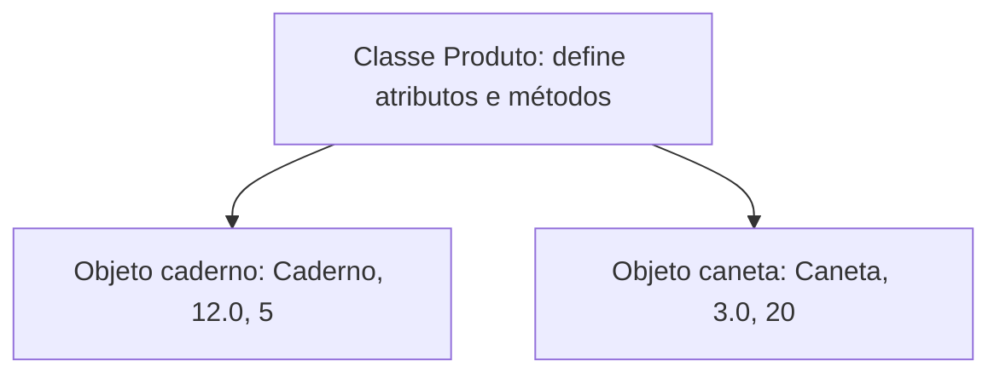
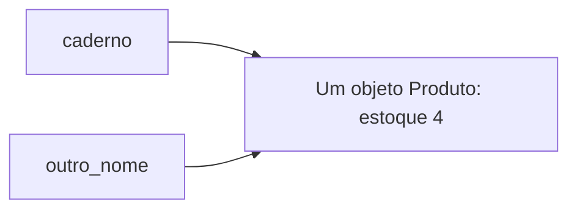

# Tópico 01 — Introdução à Programação Orientada a Objetos

## Objetivos da aula

Ao final desta aula, o aluno deverá ser capaz de:

- explicar a diferença entre classe e objeto;
- identificar atributos e métodos;
- compreender `def`, parâmetros e `return` nos exemplos;
- criar classes com `__init__` e atributos de instância;
- utilizar `self` para acessar o objeto atual;
- criar objetos independentes e acompanhar suas mudanças de estado;
- armazenar objetos em listas e percorrê-los;
- implementar comportamentos com regras simples de validação.

**Pré-requisito:** [Listas em Python](../Módulo%2001/08%20-%20Listas.md) e os conteúdos anteriores do Módulo 01.

**Organização sugerida:** dois encontros. No primeiro, trabalhe até a seção 10 e os exercícios 1 a 4. No segundo, retome os conceitos, estude as seções restantes e desenvolva os demais exercícios.

---

# 1. Por que mudar a forma de organizar o programa?

Até agora, utilizamos variáveis, condicionais, repetições e listas para resolver problemas.

Imagine um programa que controla produtos:

```python
nomes = ["Caderno", "Caneta"]
precos = [12.0, 3.0]
estoques = [5, 20]
```

O produto do índice `0` possui nome `Caderno`, preço `12.0` e estoque `5`.

Isso funciona, mas depende de manter três listas sincronizadas. Se removermos um nome e esquecermos de remover o preço e o estoque da mesma posição, os dados deixam de corresponder.

Podemos organizar cada produto como uma unidade que reúne:

- **dados:** nome, preço e estoque;
- **comportamentos:** repor estoque, vender unidades e calcular o valor em estoque.

Essa é uma das ideias centrais da **Programação Orientada a Objetos**, ou **POO**.

POO não substitui condicionais, repetições ou listas. Ela oferece outra forma de organizar o programa, utilizando esses mesmos recursos.

---

# 2. Classes e objetos

Uma **classe** define uma estrutura e os comportamentos de um tipo de objeto.

Um **objeto**, também chamado de **instância**, é uma ocorrência concreta dessa classe.

Podemos comparar uma classe a um modelo de ficha. Cada ficha preenchida corresponde a um objeto com seus próprios dados.



| Conceito | Exemplo |
| --- | --- |
| Classe | `Produto` |
| Objeto | Um produto específico criado a partir de `Produto` |
| Atributo | `nome`, `preco`, `estoque` |
| Método | `repor()`, `vender()`, `valor_em_estoque()` |

Uma classe pode representar elementos físicos, como produtos, ou conceitos, como uma reserva, uma tarefa ou uma partida.

---

# 3. Antes dos métodos: `def`, parâmetros e `return`

Para escrever métodos, precisamos conhecer a definição de funções.

Uma **função** reúne instruções sob um nome. Utilizamos `def` para defini-la:

```python
def calcular_total(preco, quantidade):
    total = preco * quantidade
    return total

resultado = calcular_total(12.0, 2)
print(resultado)
```

Saída:

```text
24.0
```

Vamos separar as partes:

| Parte | Significado |
| --- | --- |
| `def` | Inicia a definição da função |
| `calcular_total` | Nome escolhido para a função |
| `preco`, `quantidade` | Parâmetros: nomes que receberão os valores da chamada |
| `12.0`, `2` | Argumentos: valores fornecidos nessa chamada |
| `return total` | Encerra a função e devolve o resultado a quem chamou |

Os dois-pontos e o recuo delimitam o bloco, como nas estruturas que já estudamos.

**Definir não é executar.** O bloco da função executa quando fazemos a chamada `calcular_total(12.0, 2)`.

## Mostrar e devolver são ações diferentes

`print()` mostra algo na tela. `return` devolve um valor que pode ser guardado, comparado ou usado em outra conta.

Se uma função terminar sem executar um `return` com valor, ela devolve `None`, que representa a ausência de um valor de resultado.

Um **método de instância** é uma função definida na classe que recebe a instância sobre a qual vai trabalhar. Vamos usar esse tipo de método nesta aula.

---

# 4. Nossa primeira classe

```python
class Produto:
    def __init__(self, nome, preco, estoque):
        self.nome = nome
        self.preco = preco
        self.estoque = estoque


caderno = Produto("Caderno", 12.0, 5)
caneta = Produto("Caneta", 3.0, 20)

print(caderno.nome)
print(caderno.preco)
print(caneta.nome)
```

Saída:

```text
Caderno
12.0
Caneta
```

- `class Produto:` define a classe.
- Por convenção, nomes de classes usam iniciais maiúsculas, como `Produto` e `ContaBancaria`.
- `Produto(...)` cria uma instância e executa sua inicialização.
- `caderno` e `caneta` são variáveis que se referem aos objetos criados.
- O ponto permite acessar um atributo: `caderno.nome`.

Nos exemplos desta aula, considere preço e estoque iniciais não negativos, sendo o estoque um número inteiro. A validação completa da criação dos objetos será aprofundada em outra aula.

---

# 5. O papel de `__init__`

O método especial `__init__` inicializa o objeto recém-criado. É nele que vamos estabelecer os atributos iniciais.

```python
def __init__(self, nome, preco, estoque):
    self.nome = nome
    self.preco = preco
    self.estoque = estoque
```

Ao chamar:

```python
caderno = Produto("Caderno", 12.0, 5)
```

temos a seguinte correspondência:

| Parâmetro | Valor recebido |
| --- | --- |
| `self` | A instância que está sendo inicializada |
| `nome` | `"Caderno"` |
| `preco` | `12.0` |
| `estoque` | `5` |

`__init__` tem **dois sublinhados antes e dois depois**. Não o chame manualmente para criar outro produto: utilize `Produto(...)`.

É comum ouvir que `__init__` é o “construtor”. Mais precisamente, ele inicializa uma instância que já foi criada. Nesta etapa, basta compreender como fornecer seus dados iniciais.

Não devolva um resultado com `return` em `__init__`: ele deve retornar `None`, o que já acontece ao terminar sem um retorno explícito.

---

# 6. Por que utilizar `self`?

`self` se refere à instância que recebe a chamada do método.

Observe:

```python
self.nome = nome
```

Os dois lados têm papéis diferentes:

- `nome` é o parâmetro recebido durante a chamada;
- `self.nome` é o atributo armazenado no objeto.

Se escrevêssemos apenas `nome = nome`, não estaríamos criando o atributo da instância.

`self` é o nome usado por convenção. Nos métodos desta aula, ele precisa aparecer como primeiro parâmetro. Ao chamar um método pelo objeto, Python fornece esse argumento automaticamente.

Assim, na criação `Produto("Caderno", 12.0, 5)`, fornecemos três argumentos, embora `__init__` tenha quatro parâmetros.

---

# 7. Cada instância tem seus próprios atributos

Com a classe `Produto` definida anteriormente:

```python
caderno = Produto("Caderno", 12.0, 5)
caneta = Produto("Caneta", 3.0, 20)

caderno.estoque = 8

print(caderno.estoque)
print(caneta.estoque)
```

Saída:

```text
8
20
```

A mudança em `caderno` não alterou o objeto `caneta`.

Os atributos criados com `self` nesse exemplo são **atributos de instância**. Eles representam o estado de cada produto.

**Estado** é o conjunto de valores dos atributos de um objeto em determinado momento.

Podemos alterar atributos diretamente, mas isso permitiria escrever `caderno.estoque = -10`. Vamos começar a reunir as regras de alteração em métodos. Na próxima aula, aprofundaremos como controlar esse acesso.

---

# 8. Métodos: comportamentos do objeto

Vamos acrescentar comportamentos à classe. Utilize esta versão completa em um novo arquivo:

```python
class Produto:
    def __init__(self, nome, preco, estoque):
        self.nome = nome
        self.preco = preco
        self.estoque = estoque

    def repor(self, quantidade):
        if quantidade <= 0:
            return False

        self.estoque = self.estoque + quantidade
        return True

    def valor_em_estoque(self):
        return self.preco * self.estoque


caderno = Produto("Caderno", 12.0, 5)

reposicao_realizada = caderno.repor(3)

print("Reposição realizada:", reposicao_realizada)
print("Estoque:", caderno.estoque)
print("Valor em estoque:", caderno.valor_em_estoque())
```

Saída:

```text
Reposição realizada: True
Estoque: 8
Valor em estoque: 96.0
```

Em `caderno.repor(3)`, `self` recebe o objeto associado a `caderno`, enquanto `quantidade` recebe `3`.

O método `repor` altera o estado e devolve um booleano que informa se a operação foi realizada. Se a quantidade for inválida, o primeiro `return` encerra o método antes da alteração.

O método `valor_em_estoque` consulta os atributos e devolve um cálculo, sem alterar o estado.

Considere quantidades inteiras nas chamadas de reposição e venda desta aula.

---

# 9. Métodos que aplicam regras

Uma venda só pode acontecer se a quantidade for positiva e houver estoque suficiente.

Adicione o método abaixo **dentro da classe `Produto`**, no mesmo nível de recuo de `repor`:

```python
    def vender(self, quantidade):
        if quantidade <= 0 or quantidade > self.estoque:
            return False

        self.estoque = self.estoque - quantidade
        return True
```

Depois da definição da classe, podemos usar:

```python
caderno = Produto("Caderno", 12.0, 5)

if caderno.vender(2):
    print("Venda realizada")
else:
    print("Venda não realizada")

print("Estoque:", caderno.estoque)
```

Saída:

```text
Venda realizada
Estoque: 3
```

O método verifica os dados antes de alterar o objeto. Em uma tentativa inválida, devolve `False` e mantém o estoque anterior.

Não há `print()` dentro de `vender`. Quem chama o método decide como apresentar o resultado.

---

# 10. Acompanhar o estado: teste de mesa

Considere um produto com estoque inicial `5`. Cada operação da tabela ocorre depois da anterior:

| Operação | Estoque antes | Retorno | Estoque depois |
| --- | --- | --- | --- |
| `vender(2)` | 5 | `True` | 3 |
| `vender(4)` | 3 | `False` | 3 |
| `repor(3)` | 3 | `True` | 6 |
| `vender(6)` | 6 | `True` | 0 |
| `repor(0)` | 0 | `False` | 0 |

Vender exatamente o estoque disponível é permitido. O resultado será estoque zero.

**Para discutir:** por que precisamos testar uma venda que falha, além de uma venda que funciona?

---

# 11. Uma lista de objetos

Uma lista pode guardar objetos, assim como guarda números e textos.

Com a classe `Produto` completa definida antes deste trecho:

```python
produtos = [
    Produto("Caderno", 12.0, 5),
    Produto("Caneta", 3.0, 20),
    Produto("Borracha", 2.0, 10)
]

total = 0

for produto in produtos:
    valor = produto.valor_em_estoque()
    print(produto.nome, "Estoque:", produto.estoque)
    total = total + valor

print("Valor total em estoque:", total)
```

Saída:

```text
Caderno Estoque: 5
Caneta Estoque: 20
Borracha Estoque: 10
Valor total em estoque: 140.0
```

A cada repetição, `produto` se refere a um dos objetos da lista. Cada objeto possui os atributos que correspondem àquele produto.

`produtos[0].nome` acessa o nome do primeiro objeto. `produtos[0].vender(1)` chama um método desse objeto.

---

# 12. Duas variáveis podem se referir ao mesmo objeto

Assim como vimos com listas, uma atribuição não cria uma cópia independente de um objeto:

```python
caderno = Produto("Caderno", 12.0, 5)
outro_nome = caderno

outro_nome.vender(1)

print(caderno.estoque)
print(outro_nome.estoque)
```

Saída:

```text
4
4
```

Existe um produto com duas referências. Para ter dois produtos independentes, faça duas chamadas a `Produto(...)`.



---

# 13. Cuidado com listas compartilhadas na classe

Quando cada objeto precisa ter sua própria lista, crie-a dentro de `__init__`:

```python
class Turma:
    def __init__(self, nome):
        self.nome = nome
        self.alunos = []

    def matricular(self, nome_aluno):
        self.alunos.append(nome_aluno)


manha = Turma("Manhã")
noite = Turma("Noite")

manha.matricular("Ana")

print(manha.alunos)
print(noite.alunos)
```

Saída:

```text
['Ana']
[]
```

Escrever `alunos = []` diretamente no corpo da classe criaria um **atributo de classe**. Alterar essa lista com `append` a partir das instâncias faria com que elas compartilhassem os alunos, em vez de manter uma lista por turma.

Nesta aula, prefira criar os dados próprios de cada objeto em `__init__`.

---

# 14. O que vem depois?

POO envolve outros conceitos que desenvolveremos nas próximas aulas:

| Conceito | Ideia inicial |
| --- | --- |
| Encapsulamento | Organizar a interface do objeto e controlar como seu estado é utilizado e alterado |
| Composição | Construir um objeto utilizando outros objetos |
| Herança | Definir uma classe a partir de outra, aproveitando e especializando comportamentos |
| Polimorfismo | Utilizar objetos diferentes por meio de uma interface comum |

Não precisamos utilizar todos esses recursos em cada programa. Primeiro, precisamos saber escolher atributos e comportamentos que representem o problema.

---

# 15. Erros comuns

| Problema | O que conferir |
| --- | --- |
| `NameError` ao criar um produto | A classe foi definida antes do uso? O nome está correto? |
| `TypeError` sobre argumentos | O método tem `self`? A chamada fornece os argumentos esperados? |
| `AttributeError` ao acessar um dado | O atributo foi criado com `self`? O nome coincide com o utilizado? |
| Atributos não são inicializados | O nome `__init__` tem dois sublinhados de cada lado? |
| Um método não executa | Você escreveu os parênteses, como `produto.vender(2)`? |
| O resultado é `None` | O método apenas mostra algo ou realmente devolve um valor com `return`? |
| Dois objetos mudam juntos | São duas instâncias ou duas variáveis referindo-se à mesma instância? |
| Turmas compartilham alunos | A lista foi criada dentro de `__init__` ou no corpo da classe? |

Os recuos também fazem parte da estrutura: métodos ficam dentro da classe; as instruções de cada método ficam dentro dele.

---

# Desafio rápido em sala

Com a classe `Produto` completa, preveja a saída:

```python
primeiro = Produto("Lápis", 2.0, 4)
segundo = Produto("Lápis", 2.0, 4)
referencia = primeiro

referencia.vender(1)
segundo.repor(2)

print(primeiro.estoque)
print(segundo.estoque)
print(referencia.estoque)
```

Explique quantos objetos foram criados e qual deles cada variável referencia. Só depois confira no computador.

---

# Exercícios

Crie um arquivo `.py` para cada exercício. Utilize classes, métodos e os recursos do Módulo 01. Não é necessário usar herança, bibliotecas ou tratamento de exceções.

Considere entradas com tipos corretos. Nos exercícios com quantidades, utilize inteiros; nos exemplos de valores monetários, utilize números simples. O uso de `float` aqui é didático; sistemas financeiros reais exigem cuidados adicionais de representação e arredondamento.

## Exercício 01 — Cadastro de livros

**Arquivo: `01_livros.py`**

Crie a classe `Livro`, com os atributos `titulo`, `autor` e `paginas`, recebidos em `__init__`.

Crie dois livros diferentes e apresente seus dados. Altere o número de páginas de apenas um deles e mostre os dois novamente.

**Para explicar:** quais são a classe, as instâncias e os atributos? A alteração afetou os dois livros?

## Exercício 02 — Área de um retângulo

**Arquivo: `02_retangulo.py`**

Crie a classe `Retangulo`, inicializada com `largura` e `altura`, ambas positivas. Implemente `calcular_area()`, que devolve a multiplicação dessas medidas.

Crie dois objetos e mostre suas áreas fora do método. Teste com medidas `4` e `3`: área `12`.

**Para explicar:** qual é a diferença entre retornar a área e mostrá-la dentro do método?

## Exercício 03 — Contador de atendimentos

**Arquivo: `03_contador.py`**

Crie a classe `Contador`. Cada instância deve começar com `valor = 0` e oferecer os métodos `incrementar()` e `zerar()`.

Crie dois contadores. Incremente o primeiro três vezes e o segundo uma vez. Mostre os valores, zere somente o primeiro e mostre novamente.

**Resultado esperado:** primeiro `3` e `1`; depois `0` e `1`.

## Exercício 04 — Controle de estoque

**Arquivo: `04_estoque.py`**

Implemente a classe `Produto` com os métodos `repor`, `vender` e `valor_em_estoque` apresentados na aula.

Crie um produto de preço `5.0` e estoque `4`. Execute, nesta ordem:

1. Venda de `2` unidades.
2. Tentativa de venda de `3` unidades.
3. Reposição de `5` unidades.
4. Tentativa de reposição de `0` unidades.

Registre o retorno e o estoque após cada chamada. Ao final, mostre o valor em estoque.

**Conferência:** os estoques devem ser `2`, `2`, `7` e `7`. O valor final deve ser `35.0`.

## Exercício 05 — Empréstimo de um livro

**Arquivo: `05_emprestimo.py`**

Crie uma classe `Livro` com `titulo` e `emprestado`. O título é recebido na criação; `emprestado` começa como `False`.

- `emprestar()` deve mudar o estado para `True` e retornar `True`, desde que o livro ainda não esteja emprestado. Caso contrário, deve retornar `False`.
- `devolver()` deve mudar o estado para `False` e retornar `True`, desde que exista um empréstimo. Caso contrário, deve retornar `False`.

Teste duas tentativas de empréstimo seguidas de duas tentativas de devolução. Mostre os retornos e o estado após cada operação.

**Conferência:** os retornos são `True`, `False`, `True`, `False`.

## Exercício 06 — Turmas independentes

**Arquivo: `06_turmas.py`**

Crie a classe `Turma`, com `nome` e uma lista própria `alunos`, inicialmente vazia. Implemente `matricular(nome_aluno)` e `quantidade_alunos()`, que retorna o tamanho da lista.

Crie duas turmas. Matricule duas pessoas na primeira e uma na segunda. Mostre o nome de cada turma, seus alunos e sua quantidade.

Nomes repetidos são permitidos neste exercício. Explique onde a lista deve ser criada para que uma turma não receba os alunos da outra.

## Exercício 07 — Relatório de produtos

**Arquivo: `07_relatorio.py`**

Utilize a classe `Produto` e uma lista com três instâncias. Percorra a lista para mostrar nome, estoque e valor em estoque de cada uma.

Mostre também:

- o valor total em estoque;
- a quantidade de produtos cujo estoque é zero.

Teste com `Produto("Caderno", 10.0, 2)`, `Produto("Caneta", 3.0, 0)` e `Produto("Borracha", 2.0, 5)`.

**Resultado esperado:** total `30.0` e um produto sem estoque. Repita com uma lista vazia: o total e a contagem devem ser zero.

## Exercício 08 — Conta com operações validadas

**Arquivo: `08_conta.py`**

Crie a classe `Conta`, recebendo apenas `titular`. O saldo inicial deve ser zero.

Implemente:

- `depositar(valor)`: aceita somente valores positivos;
- `sacar(valor)`: aceita somente valores positivos e menores ou iguais ao saldo;
- ambos os métodos retornam `True` quando realizam a operação e `False` quando a recusam, preservando o saldo em caso de recusa.

Crie duas contas independentes. Na primeira, deposite `50`, saque `20`, tente sacar `40` e tente depositar `-10`. A segunda deve permanecer com saldo zero.

**Conferência:** saldo final da primeira conta `30`; retornos `True`, `True`, `False`, `False`.

---

# Desafio extra — Biblioteca com menu

**Arquivo: `09_biblioteca.py`**

Utilize a classe `Livro` do exercício 05 e uma lista com três livros de títulos diferentes. Construa um menu:

```text
1 - Mostrar livros e disponibilidade
2 - Emprestar um livro
3 - Devolver um livro
0 - Sair
```

Nas opções 2 e 3, leia o título e procure o objeto com um `for`. Considere a correspondência exata entre os textos.

- Se encontrar, chame o método adequado e apresente uma mensagem conforme seu retorno.
- Se não encontrar, informe `Livro não encontrado`.
- Trate opções desconhecidas com uma mensagem.
- Repita o menu até escolher `0`.

**Teste:** emprestar um livro disponível, tentar emprestá-lo novamente, devolvê-lo, tentar devolver um livro disponível e procurar um título inexistente.

As regras de empréstimo devem permanecer nos métodos. O menu fica responsável por receber entradas, localizar o objeto e mostrar os resultados.

---

# Resumo do tópico

| Recurso | Finalidade |
| --- | --- |
| `class Nome:` | Define uma classe |
| `Nome(...)` | Cria e inicializa uma instância |
| `def` | Define uma função ou um método |
| `__init__` | Inicializa os atributos de uma instância |
| `self` | Referência à instância que recebe a chamada |
| `self.atributo` | Acessa um atributo da instância |
| `objeto.metodo(...)` | Chama um método por meio do objeto |
| `return` | Encerra a chamada e devolve um resultado |
| Lista de objetos | Reúne instâncias para percorrer, consultar e utilizar |

## Conferência antes de entregar

- Cada objeto começa com os atributos necessários?
- Os métodos utilizam `self` para acessar os dados da instância?
- As operações inválidas preservam o estado anterior?
- Os métodos devolvem os valores exigidos pelo enunciado?
- Os testes incluem sucesso, recusa e valores nos limites?
- Objetos que deveriam ser independentes foram criados separadamente?
- Você consegue explicar o estado de cada objeto após cada chamada?